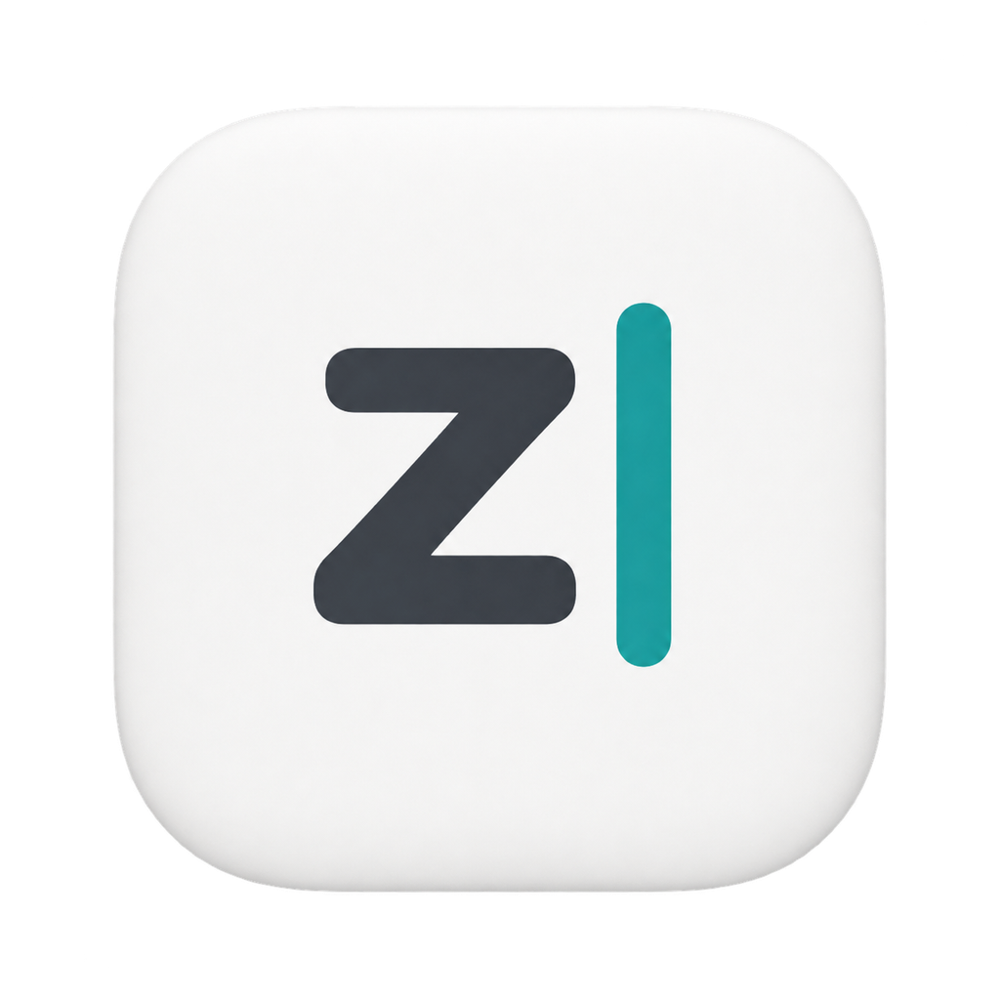

<p align="center">
  
</p>

# ztype

**A free, open-source alternative to Cotypist for Mac.**

Local, context-aware typing completion for macOS. Suggestions appear as gray
inline text and are inserted only when you accept them.
ztype is an independent project, not affiliated with Cotypist.

[中文说明](README.zh-CN.md) · [Download](../../releases/latest) · [Contributing](CONTRIBUTING.md)

## Features

- On-device inference with Qwen3 1.7B and llama.cpp/Metal.
- Context from the focused text field, with bounded reads around the caret.
- Tab accepts the next word; Option+Tab accepts the entire remaining suggestion.
- Consecutive Tabs keep consuming the same suggestion without regenerating.
- New input discards the old remainder and predicts from the updated context.
- Menu-bar operation, an optional trial editor, and no persistent Dock icon.
- Debouncing, cancellation, low-power handling, thermal pauses, and idle unloading.
- Capability-based Accessibility integration, not a list of app-specific patches.

## Install

Requires an **Apple Silicon Mac running macOS 14 or later**.

1. Download `ztype-0.1.0-arm64.dmg` from [Releases](../../releases/latest).
2. Open the disk image and drag `ztype.app` to `Applications`.
3. Launch the installed app, not the copy inside the disk image.
4. Enable cross-app completion and grant Accessibility and Input Monitoring
   permission in System Settings. Check that Tab takeover is available.

The disk image includes the inference runtime and local model. No separate model
download or cloud API key is required.

**Signing:** the initial public build is ad-hoc signed and is **not notarized**.
macOS may block the first launch. Verify the download and the accompanying
SHA-256 file, and follow [Apple's guidance](https://support.apple.com/en-us/102445)
only if you trust the app. Do not disable Gatekeeper. Ad-hoc-signed updates may
require granting Accessibility and Input Monitoring permission again.

## Build

Requires Swift 6 or later and Python 3.12 or later, in addition to the platform
requirements above. Install Xcode or its Command Line Tools first.

```bash
git clone https://github.com/xiaohei210509/ztype.git
cd ztype
python3 script/setup_engine.py
./script/build_and_run.sh --verify
```

Upstream runtime and model versions are pinned in
[`Resources/runtime-assets.json`](Resources/runtime-assets.json). Downloads are
verified with SHA-256. Model weights, compiled runtimes, build output, and local
signing material are not part of the source repository.

```bash
./script/test.sh
./script/package_dmg.sh
```

Tests do not require model downloads or Accessibility permission. Packaging
produces a separate release-mode bundle and disk image without replacing or
launching the installed app. See [distribution notes](docs/distribution.md).

## Privacy And Safety

Completion requests stay on this Mac. Inference uses an authenticated loopback
service, not a cloud endpoint. ztype reads only the focused editor, does not save
document text to settings or logs, and does not train on your typing.

Cross-app acceptance briefly leases the clipboard to invoke the editor's native
paste command. Existing clipboard formats are retained in memory and restored
after confirmation; a new user copy is never overwritten. Forced termination
cannot guarantee clipboard restoration.

Password fields, terminals, and common password managers are excluded. An
unreadable or unverified target is not blindly edited. Completions are predictions,
not verified facts; review them before accepting.

## Limitations

Cross-app behavior depends on the editor's Accessibility support. The shared
readers and acceptance path have regression coverage, but this does not establish
compatibility with every application.

Composition-based input methods are conservatively paused in cross-app mode to
avoid conflicting with IME confirmation keys. The trial editor detects marked
text. Full Chinese IME compatibility is not yet established. Cold-start model
loading adds latency. Intel Macs, Windows, Linux, automatic updates, and login
items are not currently supported by the release.

See the [detailed Chinese documentation](README.zh-CN.md) for architecture,
resource policies, permission diagnostics, and reproducible benchmarks.

## License

Original ztype source is licensed under [MIT](LICENSE).
llama.cpp remains MIT-licensed and the Qwen3 model remains Apache-2.0-licensed.
Full upstream licenses are in [`Resources/licenses`](Resources/licenses), with
attribution in [Third-Party Notices](Resources/ThirdPartyNotices.md).
The app icon is AI-generated; its prompt is documented in [app-icon notes](docs/app-icon.md).
